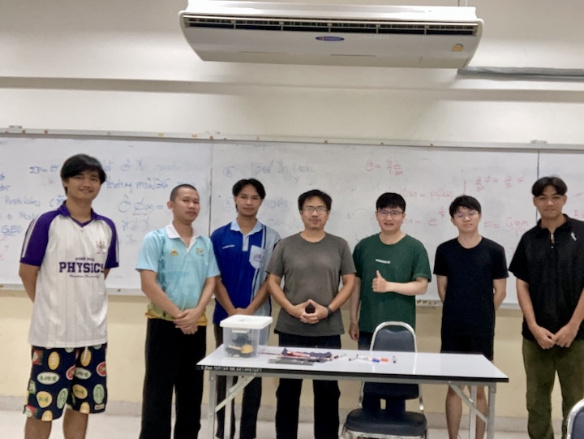

# Quantum Physics

สวัสดีครับ ติวควอนตัมเบื้องต้น เราจะเรียน 5 คาบด้วยกัน เริ่มเวลา 21:30 น. ห้อง SC5-217 ภาควิชาฟิสิกส์ คณะวิทยาศาสตร์ มหาวิทยาลัยนเรศวร

## รวม Simulation สำหรับห้องเรียน

นี้เป็นการแก้สมการ __ออกมาโดยตรง__ ไม่ใช่ภาพเคลื่อนไหวเพื่อแสดงแนวคิดเท่านั้น ทั้งนี้เพื่อให้เรามั่นใจว่า สิ่งที่นำมาแสดง เป็นปรากฏการณ์จริง ที่เกิดขึ้นหากนักเรียนสามารถเข้าไปอยู่ในโลกของควอนตัม

1. [Classic](https://teepanis.github.io/lecture-notes/quantum/quantum_01_classic.html) นำเข้าสู่เนื้อหาว่า ควอนตัม เริ่มเข้ามามีบทบาทอย่างไร 
2. [Tunnelling](https://teepanis.github.io/lecture-notes/quantum/quantum_01_tunnelling.html) แสดงปรากฏการณ์ทะลวงผ่านของควอนตัม และนำเสนอสมการ Time Dependent Schrödinger และใหันักเรียนได้เห็นผลลัพธ์ของสมการ โดยยังไม่ต้องใช้คณิตศาสคร์แก้ออกมาด้วยตนเอง  
3. [Box](https://teepanis.github.io/lecture-notes/quantum/quantum_02_box.html) Particle in a Box นี้เป็นโจทย์ที่นักเรียนทุกคนต้องทำในวิชาควอนตัม ตัว Simulation ออกแบบให้นักเรียนเข้าใจแนวคิดของ Boundary Condition และ Normalization Condition ได้ชัดเจนขึ้น  
4. [Design](https://teepanis.github.io/lecture-notes/quantum/quantum_03_molecular_design.html) ออกแบบโมเลกุล นี้เป็นการประยุกต์แนวคิดของ Particle in a Box มาใช้ออกแบบโมเลกุลทางเคมี การคำนวณนั้นให้ผลลัพธ์แม่นตรงกับโปรแกรมระดับงานวิจัยเช่น GAMESS หรือ Siam Quantum 2 (https://doi.org/10.1063/5.0310183) เพียงท่านบอกนักเรียนว่า ให้เลื่อนระยะ \$R\$ จนกว่าจะได้พลังงานต่ำสุด เราก็สามารถทำนายหรือออกแบบโมเลกุล $H_2$ ได้ด้วยควอนตัม 

## คาบ 1 - 12 ตุลาคม 2569
บรรยายบนกระดานเป็นหลัก โดยมี animation ประกอบ
1. ฟิสิกส์คลาสสิก กลายเป็น ควอนตัม อย่างไร? [Classic](https://teepanis.github.io/lecture-notes/quantum/quantum_01_classic.html)
2. รู้จักปรากฎการณ์ ทะลุทะลวงเชิงควอนตัม และสมการ Time Dependent Schrödinger [Tunnelling](https://teepanis.github.io/lecture-notes/quantum/quantum_01_tunnelling.html) 
3. ทบทวน Complex Number - Integer, Rational, Irrational, Imaginary, Complex, Euler Identity, Absolute Value, Examples
4. ตัวอย่างใช้ AI เป็นผู้ช่วยสร้างสื่อการสอน - [Prompt](https://github.com/teepanis/lecture-notes/blob/main/quantum/quantum_01.md)

## คาบ 2 - 13 ตุลาคม 2569
1. สถานะคงตัว (Steady State, Eigen State)
2. รู้จักสมการ Time Independent Schrödinger
3. Particle in a Box [Box](https://teepanis.github.io/lecture-notes/quantum/quantum_02_box.html)
4. Boundary Condition และ Normalization Condition
5. ตัวอย่างใช้ Wolfram Alpha ช่วยทางแคลคูลัส [ψ(x) Normalization](https://www.wolframalpha.com/input?i=integrate+sin%28n+pi+x+%2F+L%29%5E2+dx+from+0+to+L+assuming+n+is+an+integer)

## คาบ 3 - 14 ตุลาคม 2569
1. ออกแบบโมเลกุลด้วยควอนตัม [Design](https://teepanis.github.io/lecture-notes/quantum/quantum_03_molecular_design.html)
2. Tranmission Coefficients (Tunnelling)
3. Complex Plane Wave - [Python Code](https://github.com/teepanis/lecture-notes/blob/main/quantum/quantum_01.md)

## คาบ 4 - 15 ตุลาคม 2569
1. Time Dependent System and Superposition
2. Moving Particle in a Box - [Python Code](https://github.com/teepanis/lecture-notes/blob/main/quantum/quantum_04.md)
3. Eigen State Transition with Perturbation & Fermi Golden Rule
4. How Laser Works in Depth [PhET Simulation](https://phet.colorado.edu/en/simulations/lasers)

## คาบ 5 - 16 ตุลาคม 2569
1. Postulates in Physics and Mathematics
2. Quantum Postulates
3. Operators and Expectation Values
4. มองไปข้างหน้า
5. พิธีปิด มอบรางวัล
